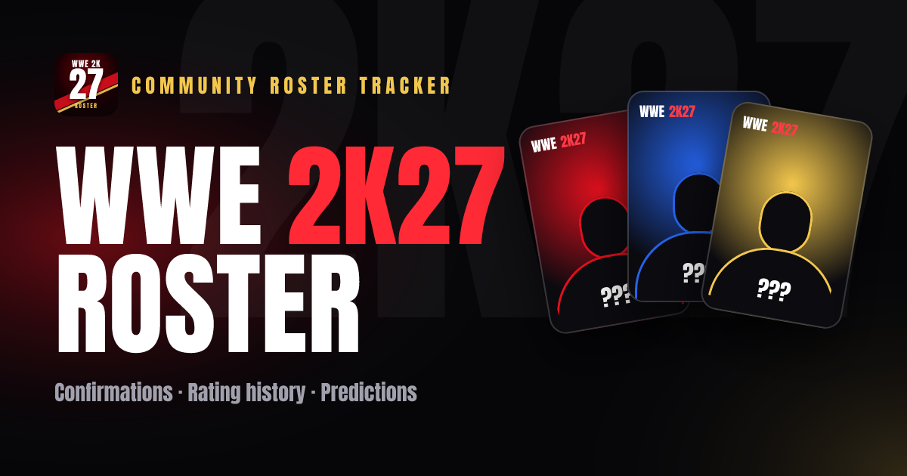

# WWE 2K27 Roster Tracker



A community-powered roster tracker for WWE 2K27. The roster starts empty. Anyone can add a superstar from the built-in database (the full current Raw, SmackDown and NXT roster, free agents, and 2K legends), but they have to say **how** that superstar was confirmed. Every entry is shared, so once one person adds a superstar, everyone sees them.

## Features
- **Shared live roster.** Entries are stored in Vercel Blob, and the first confirmation for each superstar wins.
- **Proof required.** Every entry needs a confirmation method (official reveal, trailer, pre-order, DLC, leak, insider, …), details and an optional source link.
- **Profiles on a WWE 2K27 backdrop**, showing:
  - which mainline appearance 2K27 would be (counting the full SmackDown! → SvR → WWE '12/'13 → 2K lineage, plus the 2K-era count)
  - overall rating history on a graph
  - every WWE game they've been in, including spin-offs
- **Predictions tab** for unofficial community rating predictions, shown as an average and a histogram.
- **Reports.** Anyone can flag a wrong or weakly sourced entry. Entries with 3 or more reports show as *Disputed*.

## Renders
Superstar renders are freely licensed photos from Wikimedia Commons. The backgrounds are removed on-device with Apple Vision, and each profile credits the photo's author and licence. Superstars without a free photo get a stylised silhouette. To regenerate them on macOS 14 or later:

```bash
RAW_DIR=/tmp/raw node scripts/fetch-photos.mjs
swift scripts/cutout.swift /tmp/raw public/renders
node scripts/build-renders.mjs
```

## Development
```bash
npm install
npm run dev
```
Without `BLOB_READ_WRITE_TOKEN`, the app uses an in-memory store. Note: `vercel link` / `vercel env pull` write the **production** Blob token into `.env.local`, so run local tests with `BLOB_READ_WRITE_TOKEN= npm run dev` to avoid writing to the live roster.

*Fan-made. Not affiliated with WWE, 2K or Visual Concepts. Rating history is community-compiled and may be approximate.*
